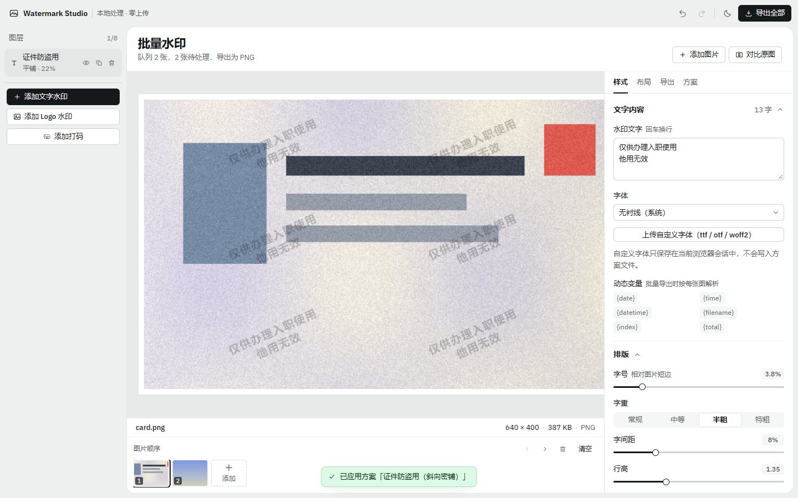
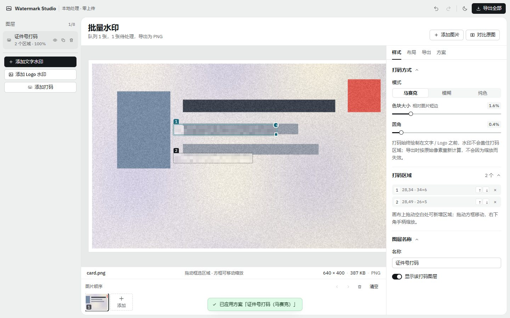
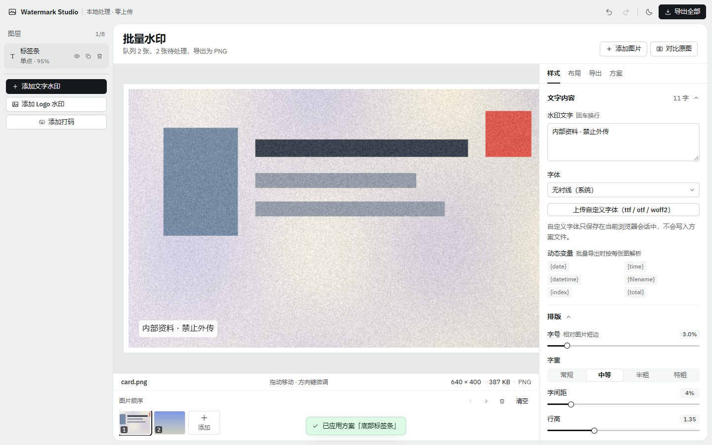
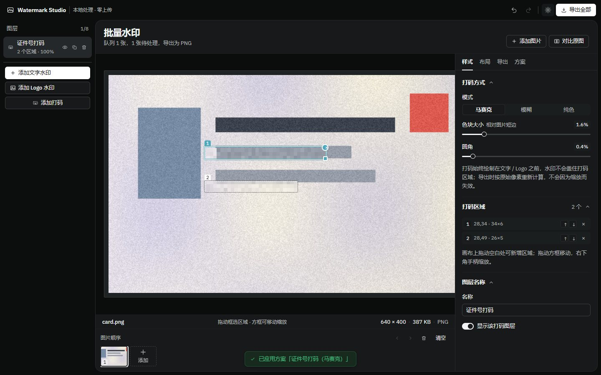
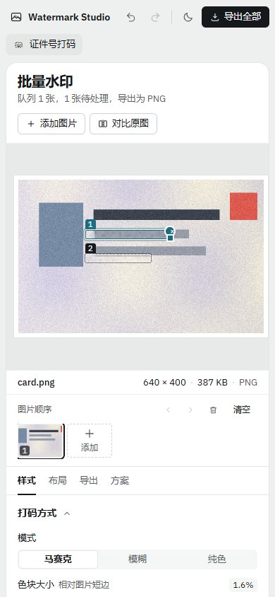

# Watermark Studio · 本地批量图片水印工坊

> 纯前端、零上传的批量图片水印工具。**多图层**叠加文字与 Logo，九宫格 / 平铺 / 网格三种排版，透明度、字体、描边、阴影、背景色块全可调，基于 `Canvas + Web Worker` 批量渲染并打包 ZIP 下载。
>
> 参考并重写了 [cuijianzhuang/photo-watermark](https://github.com/cuijianzhuang/photo-watermark)（原生 JS 单文件版），在架构、功能深度与工程化上做了系统性升级。

  

**在线试用**：<https://watermark-studio.edgeone.cool> · **代码**：<https://github.com/cccgitzh/watermark-studio>



<details>
<summary>更多截图（打码 / 标签条样式 / 深色主题 / 移动端）</summary>

| 区域打码（马赛克） | 标签条 + 描边 | 深色主题 | 移动端 390px |
| --- | --- | --- | --- |
|  |  |  |  |

</details>

---

## 为什么重写

原项目是一个 60KB 的原生 JS 单文件应用：`index.html` + `css/styles.css` + `js/script.js`，靠全局变量与 DOM 查询驱动，功能集中在「文字水印 + 三种布局 + JSZip 批量下载」。它把「离线、隐私」这件事做对了，但代码结构与能力边界也停在那个阶段。

本项目保留它最重要的主张 —— **图片永远不离开浏览器** —— 并把水印从「一段文字」升级成「一套可复用的图层方案」，同时补齐了工程化底座（类型、模块边界、单测、构建、CI、部署）。

| 维度 | 原项目 | Watermark Studio |
| --- | --- | --- |
| 代码组织 | 单文件 60KB，全局函数 + DOM id 耦合 | `core`（纯逻辑）/ `state`（状态）/ `components`（视图）/ `workers`（渲染线程）四层分离，TypeScript 严格模式 |
| 水印模型 | 单一文字水印 | 多图层（文字 / Logo / 打码），每层独立排版、透明度、混合模式与层级顺序 |
| 打码 | 仅靠文字遮盖，没有真正的像素处理 | 区域化打码图层：马赛克 / 模糊 / 纯色，画布拖拽框选、移动、缩放，导出按原始像素重算 |
| 排版 | 平铺 / 单点（5 个固定位）/ N 个等分 | 单点（九宫格 + 边距 + 百分比偏移 + **画布拖拽**）/ 平铺（横纵间距独立、错行、旋转扩边）/ 网格（任意行列） |
| 样式 | 字号倍率、颜色、透明度、旋转、加粗斜体 | 字体族与自定义字体上传、字重、字距、行高、斜体、描边、阴影、背景色块（圆角/内边距）、6 种混合模式 |
| 文本变量 | 无 | `{date}` `{time}` `{datetime}` `{filename}` `{index}` `{total}`，批量导出时按每张图解析 |
| 批量性能 | 主线程逐张绘制 | `OffscreenCanvas + Worker` 渲染池（并发 2），主线程不卡；不支持时自动回退主线程 |
| 导出 | 固定格式下载 | 格式（原格式/PNG/JPEG/WebP）、质量、长边上限、命名模板（6 个占位符）、ZIP 打包、剪贴板复制 |
| 编辑体验 | 无撤销 | 撤销/重做（连续滑动自动合并为一步）、快捷键、按住空格对比原图、主题切换 |
| 方案复用 | 无 | 6 套内置预设 + 自定义方案（localStorage）+ 方案 JSON 导入导出 |
| 图片处理 | 直接绘制 | EXIF 方向矫正、超 8192px 自动降采样、上限 60 张、逐张跳过/排序 |
| 质量保障 | 无测试 | 35 个单元测试 + 32 项 Playwright 端到端断言、`tsc --noEmit`、GitHub Actions CI |
| 部署 | GitHub Pages + Docker | EdgeOne Makers / EdgeOne Pages / GitHub Pages / Docker，含 PWA 离线安装 |

---

## 功能清单

### 水印能力
- **图层系统**：文字图层 + Logo 图层，最多 8 层，可显示/隐藏、复制、删除、上下移动
- **文字**：多行内容、回车换行、中文避头点避尾点自动断行、拉丁单词不拆词
- **字体**：8 组内置中英文字体栈 + 本地上传 `.ttf / .otf / .woff / .woff2`（会话内生效）
- **排版**：字号（按图片短边等比，跨分辨率一致）、字重 4 档、字距、行高、斜体
- **颜色与质感**：任意色值（支持 `rgba()`）、透明度、描边（宽度/颜色）、阴影（模糊/XY 偏移/颜色）、背景色块（颜色/透明度/内外边距/圆角）
- **叠加**：正常 / 正片叠底 / 滤色 / 叠加 / 柔光 / 差值，+ 旋转 -180°~180°
- **Logo**：PNG/SVG/WebP/JPEG，宽度按短边比例，同样支持旋转与混合模式
- **动态变量**：`{date}` `{time}` `{datetime}` `{filename}` `{index}` `{total}`，批量导出时每张图各自解析（适合归档编号、时间戳）

### 打码（真实像素处理）
- **三种模式**：马赛克（可调色块大小）/ 高斯模糊（可调半径）/ 纯色块（颜色 + 不透明度），统一支持圆角
- **区域编辑**：画布上拖拽框选新区域、拖动方框移动、右下角手柄缩放、区域列表可逐条删除与微调
- **安全顺序**：打码层始终绘制在文字 / Logo 之前，水印不会盖住打码区；导出时按原始像素重算，缩放不会让打码失效
- **失败兜底**：浏览器不支持 `ctx.filter` 时，「模糊」自动降级为马赛克，避免出现「看起来糊了其实没打码」

### 版式与定位
- **单点**：九宫格锚点 + 边距 + 水平/垂直百分比偏移，可直接在画布上拖动，或用方向键微调（`Shift` + 方向键更精细）
- **平铺**：横纵间距独立（按水印自身尺寸计算）、隔行错位、旋转后自动扩边保证四角不漏印
- **网格**：1~8 行列任意，自动均分

### 批量与导出
- **导入**：点击 / 拖拽到窗口任意位置 / `Ctrl+V` 粘贴截图；队列内可随时用「添加图片」或缩略图末尾的「+」继续追加，单批最多 60 张
- **队列**：缩略图预览、点击切换、前后排序、单张跳过、单张移除、一键清空
- **导出**：原格式 / PNG / JPEG / WebP；压缩质量；长边上限（1280~8192）；命名模板 `{name} {index} {date} {w} {h} {ext}`
- **输出方式**：ZIP 打包、逐张下载、仅当前图片、复制到剪贴板
- **进度**：实时进度 + 已用时 + 预计剩余 + 失败计数，可中途取消

### 体验
- 撤销 / 重做（`Ctrl/⌘+Z`、`Ctrl/⌘+Shift+Z`、`Ctrl/⌘+Y`），滑杆连续调整合并为一步
- 按住 `空格` 快速对比原图
- 浅色 / 深色主题（跟随系统，可手动切换并记忆）
- 响应式三栏布局，窄屏自动降级为纵向堆叠
- PWA：可安装到桌面，断网可用

### 隐私
- 无后端、无分析脚本、无外部字体 CDN；构建产物不含任何第三方请求
- 图片仅存在于内存，刷新即清除；只有「方案（不含图片）」会写入 `localStorage`

---

## 快速开始

```bash
git clone https://github.com/cccgitzh/watermark-studio.git
cd watermark-studio
npm install
npm run dev        # http://localhost:5173
```

```bash
npm run build      # 类型检查 + 生产构建 → dist/
npm run preview    # 本地预览构建产物 http://localhost:4173
npm test           # 单元测试（vitest）
npm run typecheck  # 仅类型检查
```

要求 Node ≥ 18（推荐 20/22）。

---

## 界面与设计规范

界面按 **打样台** 组织：一层石灰底色外框承载顶栏与图层面板，工作区是一张内嵌 8px、16px 圆角、1px 边的白色纸张；照片像打样稿一样带白色留白放在凹下的台面上，说明行是它的标签，胶卷条是接触印相。色彩只用于选择与状态，主操作是近黑色按钮。

- **设计变量**：`src/styles/tokens.css` —— 表面（外框 / 纸张 / 台面 / 分组）、线条（边 / 分隔 / 控件）、墨色三档、状态色、字号、圆角、间距，浅色与深色两套
- **字体**：IBM Plex Sans 可变字重（latin 子集，自托管于 `public/fonts/`，OFL 1.1）+ IBM Plex Mono（仅尺寸、坐标、计数等数字）；中文回落系统黑体，零外部请求
- **字号**：22 / 16 / 14 / 13 / 12 / 11 六级 —— 标题 22，正文 14，标签与控件 13，元信息 12，徽标 11（下限）
- **圆角**：纸张 16 / 面板 8 / 控件 6 / 徽标 4；**阴影**只给浮层（toast、进度对话框、拖拽提示），静置元素一律 1px 边或换底色
- **对齐**：外框 8px 内缩，纸张内 20px 边距，检查器 16px 边距；顶栏 48px、页签 40px、控件 30px、图层行 34px、缩略图 64×48
- **状态**：hover 换底色、focus 用 accent 2px 外环、disabled 45% 透明度、选中图层用中性灰填充（不用描边，避免与焦点混淆）
- **断点**：≥1240 三栏（228 / 自适应 / 340）；≤1240 收窄为 208 / 320；≤980 外框折叠 —— 图层变横向条、属性面板下移、纸张铺满；≤640 单列、操作换行、触控目标 ≥36px

字体许可：`public/fonts/OFL.txt`。

## 项目结构

```
watermark-studio/
├── src/
│   ├── core/                   # 领域内核：不依赖 React，可独立测试
│   │   ├── types.ts            # 文档模型（图层 / 布局 / 打码区域 / 导出设置）
│   │   ├── layers.ts           # 图层类型守卫（isTextLayer / isRedactLayer …）
│   │   ├── defaults.ts         # 默认值、字体表、预设、uid、克隆
│   │   ├── textLayout.ts       # 中英混排断行（避头点 / 避尾点 / 硬切）
│   │   ├── tokens.ts           # 文字动态变量解析（{date} {filename} …）
│   │   ├── geometry.ts         # 锚点计算（单点 / 平铺 / 网格）、尺寸适配
│   │   ├── renderer.ts         # 唯一的绘制入口：底图 + 图层 → Canvas
│   │   ├── imageSource.ts      # 解码、EXIF 纠正、降采样、dataURL 互转
│   │   └── export.ts           # MIME/扩展名、命名模板、编码、下载、剪贴板
│   ├── workers/
│   │   ├── render.worker.ts    # OffscreenCanvas 渲染 + 编码
│   │   └── pool.ts             # 渲染池（排队 / 并发 / 主线程回退）
│   ├── state/
│   │   ├── editorStore.ts      # zustand：图层、导出、图片队列、撤销栈、预设
│   │   └── batchStore.ts       # 批处理进度与取消信号
│   ├── features/
│   │   └── batchExport.ts      # 批量导出编排（并发、命名、ZIP、复制）
│   ├── hooks/
│   │   ├── useKeyboardShortcuts.ts
│   │   └── useLogoImages.ts    # dataURL Logo → ImageBitmap（带缓存）
│   ├── components/
│   │   ├── TopBar.tsx  LayersPanel.tsx  PreviewStage.tsx  Filmstrip.tsx
│   │   ├── Inspector.tsx        # 样式 / 布局 / 导出 / 方案 四个页签
│   │   ├── StylePanel.tsx  LayoutPanel.tsx  ExportPanel.tsx  PresetPanel.tsx
│   │   ├── controls.tsx         # 表单原语（滑杆 / 分段 / 开关 / 取色 / 九宫格）
│   │   ├── DropZone.tsx  ToastHost.tsx  ProgressOverlay.tsx  icons.tsx
│   ├── styles/                  # fonts.css（自托管字体）/ tokens.css（设计变量）
│   │                            # base.css（外壳与画布）/ panels.css（检查器与控件）
│   ├── App.tsx  main.tsx
├── tests/                       # 35 个单测：断行 / 几何 / 命名 / 变量
│   └── e2e/                     # Playwright 冒烟：导入 → 编辑 → 打码 → 导出（32 断言）
├── public/                      # favicon / manifest / service worker
├── docs/PLAN.md                 # 项目规划、功能清单、技术选型与路线图
├── .github/workflows/           # CI（类型检查 + 测试 + 构建）与 EdgeOne 部署
├── Dockerfile  nginx.conf       # 自托管方案
```

### 数据流

```
文件/剪贴板
   → decodeImage（EXIF 纠正、降采样）→ ImageBitmap 存入 editorStore.images
图层编辑 → editorStore.commit()（写撤销栈，滑杆按 key 合并）
        → PreviewStage 用 requestAnimationFrame 调 renderer 重绘预览（按显示尺寸 × DPR）
导出 → batchExport 逐张组装 RenderJob
        → RenderPool（Worker + OffscreenCanvas）渲染 → encodeCanvas → Blob
        → 命名模板 → ZIP / 单张下载 / 剪贴板
```

**设计要点**

1. **比例化参数**：字号、边距、间距、描边、阴影全部相对「图片短边」或「字号」表达，因此预览（几百 px）与导出（几千 px）视觉完全一致，同一套配置可跨分辨率复用。
2. **单一渲染入口**：`renderer.ts` 同时服务预览与导出，预览和成品不会出现「看起来不一样」的偏差。
3. **上下文无关的绘制**：`Ctx2D` 类型同时兼容 `CanvasRenderingContext2D` 与 `OffscreenCanvasRenderingContext2D`，同一份代码可在 Worker 中运行。
4. **可测内核**：断行与布局都是纯函数（注入 `measure`），不需要真实 Canvas 即可单测。

---

## 部署

### 方案一：EdgeOne Makers（推荐，CLI 一键）

```bash
npm i -g edgeone@latest      # 需 ≥ 1.6.0
edgeone login                # 浏览器授权
edgeone makers deploy -n watermark-studio --json
```

CLI 会自动识别 Vite 项目、执行 `npm run build` 并上传 `dist/`，返回形如
`https://watermark-studio-xxxx.edgeone.cool?eo_token=...&eo_time=...` 的访问地址（**必须带完整查询参数**，否则 401）。

CI 中可用 Token 部署，见 `.github/workflows/deploy-edgeone.yml`（需在仓库 Secrets 配置 `EDGEONE_API_TOKEN`）。

### 方案二：EdgeOne Pages 控制台（Git 自动构建）

1. 推送仓库到 GitHub；
2. EdgeOne 控制台 → Pages → 新建项目 → 关联该仓库；
3. 构建配置：

| 项 | 值 |
| --- | --- |
| 框架预设 | Vite |
| 构建命令 | `npm run build` |
| 输出目录 | `dist` |
| Node 版本 | 20 |

4. 之后每次 push 到 `main` 自动构建发布，PR 生成预览环境。

> 本项目为纯静态 SPA，无路由、无环境变量、无 Node 运行时依赖，任何静态托管（EdgeOne / GitHub Pages / Netlify / Vercel / 对象存储 + CDN）都可用。`vite.config.ts` 的 `base` 默认为 `/`；若部署在子路径（如 `https://user.github.io/watermark-studio/`），把 `base` 改成 `'/watermark-studio/'`。

### 方案三：Docker 自托管

```bash
docker build -t watermark-studio .
docker run -d -p 8080:80 --name watermark watermark-studio
# → http://localhost:8080
```

镜像为多阶段构建：`node:20-alpine` 编译 → `nginx:alpine` 托管，`nginx.conf` 已配置 SPA 回退、gzip、静态资源长缓存与 CSP：

```
Content-Security-Policy: default-src 'self'; script-src 'self'; style-src 'self' 'unsafe-inline';
  img-src 'self' data: blob:; connect-src 'self' data: blob:; worker-src 'self' blob:;
  object-src 'none'; base-uri 'none'; frame-ancestors 'none'
```

### 浏览器要求

| 能力 | 要求 | 降级行为 |
| --- | --- | --- |
| 基础水印 | 所有现代浏览器 | — |
| EXIF 自动纠正 | Chrome/Edge 90+、Safari 16+ | 按原始像素绘制 |
| Worker 渲染 | 支持 `OffscreenCanvas` | 自动回退主线程 |
| 自定义字体 | `FontFace` + `ArrayBuffer` | 不可用时按钮报错提示 |
| 复制到剪贴板 | `ClipboardItem`（需 HTTPS） | 按钮提示不支持 |

---

## 测试

```bash
npm test          # 35 个单元测试（vitest）
npm run build     # 类型检查 + 生产构建
npm run test:e2e  # 32 项端到端断言（需本机 Chrome，脚本会自动起 preview）
```

| 文件 | 覆盖 |
| --- | --- |
| `tests/textLayout.test.ts` | 显式换行、折行宽度、避头点、避尾点、拉丁不拆词、超长硬切、空文本 |
| `tests/geometry.test.ts` | 九宫格坐标、边距与偏移、平铺覆盖率与对称性、旋转扩边、错行、网格数量与兜底、长边缩放 |
| `tests/export.test.ts` | MIME 映射（含 GIF/SVG → PNG）、扩展名、命名模板六种占位符、非法字符过滤、回退规则 |
| `tests/tokens.test.ts` | 日期/时间/文件名/序号替换、大小写不敏感、未知占位符、缺值兜底 |
| `tests/e2e/smoke.mjs` | 首张上传后**继续添加**、水印绘制与对比原图、撤销/重做、拖拽定位、方向键微调、三种打码模式的像素级验证、预设、ZIP / 单张导出、深色主题、390px 响应式、零外部请求 |

> 打码相关断言不是「截图看着对」：脚本会读取画布像素，计算区域内的高频能量与标准差，验证马赛克把块内细节抹平、模糊降低梯度、纯色把区域方差压到近 0。
>
> `npm run test:e2e` 使用 `channel: 'chrome'`（本机已安装的 Chrome），不需要下载 Playwright 浏览器；也可用 `E2E_BASE_URL=https://... npm run test:e2e` 直接验线上地址。

---

## 路线图

- [x] 图形打码（马赛克 / 模糊 / 纯色区域，证件号遮挡）
- [x] 文字动态变量（时间戳 / 文件名 / 序号）
- [x] Playwright 端到端用例入库（`npm run test:e2e`）
- [ ] 每张图片独立覆盖水印参数（当前为全局统一）
- [ ] 二维码水印图层
- [ ] 打码区域的椭圆 / 画笔自由形状
- [ ] 端到端用例接入 GitHub Actions（Runner 自带 Chrome）
- [ ] 中英双语界面（i18n）

## 许可

MIT。参考项目的版权归其原作者所有，详见 [LICENSE](./LICENSE) 与文首说明。
